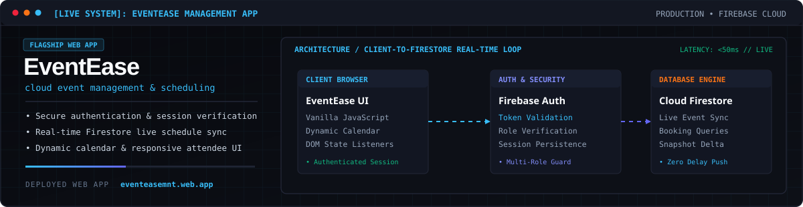

<!-- Profile README | Lander John Cueto (@cuetolanderjohn-maker) -->

  

  
  
  
  
  
  
  

## Overview

I am a software engineer and game developer based in Pasig City, Philippines.

I build production-grade web systems, deterministic 2D browser games, and applied AI automation pipelines. My focus centers on architecture: writing high-throughput, low-latency interfaces, integrating multimodal foundation models into reliable user workflows, and developing frame-perfect 60 FPS canvas engines.

* **Portfolio Website:** [cuetolanderjohn-maker.github.io/landers-portfolio](https://cuetolanderjohn-maker.github.io/landers-portfolio/)
* **Specialization:** Real-Time Cloud Architectures, 2D Deterministic Physics, Multimodal Vision, and Speech Workflows.

## Core Disciplines

  

---

## Flagship Systems

### [EventEase — Cloud-Hosted Event Management Platform](https://eventeasemnt.web.app/login)

A cloud-hosted event management platform engineered for high-responsiveness and immediate data consistency. The application features user authentication, role-based authorization, a dynamic calendar scheduling engine, and direct client-side state synchronization backed by Google Cloud Firestore.

* **Architecture:** Real-time collection listeners, optimistic UI updates, multi-tenant session validation, and zero-dependency DOM event scripting.
* **Stack:** Firebase Auth, Cloud Firestore, JavaScript (ES6+), HTML5, CSS3.

  

[Launch Live EventEase Application](https://eventeasemnt.web.app/login) &bull; [Documentation & Specs](https://cuetolanderjohn-maker.github.io/landers-portfolio/)

---

### [Lesson Plan Maker — DepEd MATATAG Curriculum Studio](https://github.com/cuetolanderjohn-maker/lesson-plan-maker)

An automated curriculum architecture application designed for faculty at La Consolacion College - Pasig. The studio converts raw textbook photography into officially standardized lesson plans for Kindergarten 2 and Grade 1, adhering strictly to DepEd Order No. 3 s. 2026 guidelines.

* **Architecture:** Multimodal vision parsing with Google Gemini and Nemotron, automated client-side image downsampling to prevent upload timeouts, local Tesseract.js OCR fallback, and structured Word (.docx) table compilation.
* **Stack:** Next.js 15, TypeScript, Tailwind CSS, Google Gemini Vision, Tesseract.js, Docx.js.

  

[Launch Studio on Netlify](https://katlessonplan.netlify.app/) &bull; [Source Code Repository](https://github.com/cuetolanderjohn-maker/lesson-plan-maker)

---

### [Thunderbolt Arcade — Deterministic 2D Game Engine](https://github.com/cuetolanderjohn-maker/Pacman-Pokemon-Edition)

A custom 2D arcade engine fusing classic maze mechanics with a Pokémon universe theme. Built to demonstrate deterministic loop scheduling, the engine maintains exact 60 FPS frame ticks, grid-aligned bounding box collision resolution, and state-machine powerup transitions.

* **Architecture:** Fixed-timestep game loop, sprite-sheet rasterization, pursuit vectors, and procedural audio synthesis via the Web Audio API.
* **Stack:** JavaScript (ES6+), HTML5 Canvas 2D, Web Audio API, Finite State Machines.

  

[View Engine Repository](https://github.com/cuetolanderjohn-maker/Pacman-Pokemon-Edition) &bull; [Play in Browser](https://cuetolanderjohn-maker.github.io/landers-portfolio/)

---

### [Video Edit Automation — Agentic Media Pipeline](https://github.com/cuetolanderjohn-maker/Video-Edit-Automation)

An automated media processing pipeline designed to integrate directly with AI coding agents. The engine takes raw spoken-word footage and outputs a fully cut, captioned vertical video with motion graphics, silence stripping, and speaker tracking.

* **Architecture:** Automated silence and breath boundary detection, word-level audio alignment via the Groq Whisper API, and programmatic canvas rendering.
* **Stack:** Node.js, Groq Whisper API, FFmpeg, HyperFrames, GSAP.

  

[View Pipeline Repository](https://github.com/cuetolanderjohn-maker/Video-Edit-Automation)

---

## Supporting Systems

* **[Interactive Engineering Portfolio](https://github.com/cuetolanderjohn-maker/landers-portfolio):** Personal web showcase featuring custom particle shaders, interactive arcade demonstrations, and accessible project dossiers. [Live Deployment](https://cuetolanderjohn-maker.github.io/landers-portfolio/).
* **[CPU Scheduler Simulation](https://github.com/cuetolanderjohn-maker/cpu-scheduler-simulation):** Operating system process scheduling engine implementing FCFS, SJF, Priority, and Round Robin scheduling algorithms in C++ and Python.
* **[Computer Vision Gesture Lab](https://github.com/cuetolanderjohn-maker/Dancing-Cat-using-5-pin-points):** Client-side gesture tracking pipeline implementing YCrCb skin color segmentation, Haar face suppression, and convex hull defect extraction in OpenCV.

---

## Activity

<picture>
  <source media="(prefers-color-scheme: dark)" srcset="./assets/contribution-arcade.svg" />
  <source media="(prefers-color-scheme: light)" srcset="./assets/contribution-arcade-light.svg" />
  
</picture>

  

  
  
  

