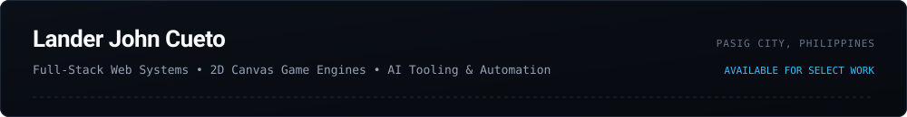

  

 

Software engineer and game developer based in Pasig City, Philippines. I engineer full-stack web applications, deterministic 2D browser games, and applied AI automation pipelines that integrate multimodal foundation models into reliable user workflows.

[Portfolio](https://cuetolanderjohn-maker.github.io/landers-portfolio/) &nbsp;&#8226;&nbsp; [GitHub](https://github.com/cuetolanderjohn-maker) &nbsp;&#8226;&nbsp; [Email](mailto:landerjohncueto@gmail.com)

---

### Selected Systems

| Project | Focus | Architecture & Key Deliverables | Technologies | Access |
| :--- | :--- | :--- | :--- | :--- |
| **EventEase** | Cloud Web Application | Cloud-hosted event management platform featuring role-based authentication, dynamic calendar scheduling, and immediate state synchronization via Google Cloud Firestore listeners. | Firebase Auth, Cloud Firestore, JavaScript (ES6+), HTML5, CSS3 | [Live Demo](https://eventeasemnt.web.app/login) |
| **Lesson Plan Maker** | Applied AI Studio | Automated curriculum processing studio built for faculty at La Consolacion College. Converts textbook photography into standardized DepEd MATATAG lesson plans with local OCR fallback and structured DOCX export. | Next.js 15, TypeScript, Gemini Vision, Tesseract.js, Docx.js | [Live App](https://katlessonplan.netlify.app/) &nbsp;&#8226;&nbsp; [Source](https://github.com/cuetolanderjohn-maker/lesson-plan-maker) |
| **Thunderbolt Arcade** | 2D Game Engine | Deterministic 2D canvas engine fusing retro maze navigation with Pokemon mechanics. Features fixed-timestep 60 FPS update ticks, pursuit vector pathfinding, bounding-box collision detection, and procedural Web Audio synthesis. | HTML5 Canvas 2D, JavaScript (ES6+), Web Audio API, State Machines | [Source](https://github.com/cuetolanderjohn-maker/Pacman-Pokemon-Edition) &nbsp;&#8226;&nbsp; [Play](https://cuetolanderjohn-maker.github.io/landers-portfolio/) |
| **Video Edit Automation** | AI Media Pipeline | Agentic media pipeline for AI coding workflows. Ingests raw video footage, detects silence and breath boundaries, performs word-level audio alignment via Groq Whisper API, and renders captioned vertical video. | Node.js, Groq Whisper API, FFmpeg, HyperFrames, GSAP | [Source](https://github.com/cuetolanderjohn-maker/Video-Edit-Automation) |
| **Interactive Portfolio** | Graphics & Shaders | Personal engineering portfolio with custom interactive particle canvas shaders, playable arcade demonstrations, and accessible project dossiers. | Vanilla JS, Canvas 2D, GLSL Shaders, CSS Grid | [Live Site](https://cuetolanderjohn-maker.github.io/landers-portfolio/) &nbsp;&#8226;&nbsp; [Source](https://github.com/cuetolanderjohn-maker/landers-portfolio) |
| **CPU Scheduler Simulation** | Systems Simulation | Algorithmic workbench implementing FCFS, SJF, Priority, and Round Robin operating system process scheduling algorithms with turnaround and wait-time diagnostics. | C++, Python, Data Structures &amp; Algorithms | [Source](https://github.com/cuetolanderjohn-maker/cpu-scheduler-simulation) |

---

### Engineering Disciplines

#### Full-Stack Web Development
- **Frontend Architectures:** TypeScript, JavaScript (ES6+), Next.js, React, Tailwind CSS, Responsive Web Design, DOM APIs.
- **Backend & Cloud:** Firebase Auth, Google Cloud Firestore, Real-Time Collection Listeners, Node.js, RESTful APIs.

#### 2D Canvas & Browser Game Engines
- **Graphics & Rendering:** HTML5 Canvas 2D Context, Sprite Sheet Rasterization, RequestAnimationFrame Timing.
- **Game Mechanics:** Fixed-timestep physics simulation, tile-based pathfinding, bounding-box collision resolution, Web Audio API procedural synthesis.

#### Applied AI & Media Automation
- **Multimodal Vision:** Google Gemini Multimodal Vision API, client-side image downsampling, Tesseract.js optical character recognition.
- **Audio & Media Pipelines:** Groq Whisper API for low-latency ASR, FFmpeg automated cutlists, silence trimming, motion graphic overlays.

---

### Contact

- **Portfolio:** [cuetolanderjohn-maker.github.io/landers-portfolio](https://cuetolanderjohn-maker.github.io/landers-portfolio/)
- **Email:** [landerjohncueto@gmail.com](mailto:landerjohncueto@gmail.com)
- **GitHub:** [@cuetolanderjohn-maker](https://github.com/cuetolanderjohn-maker)
- **Location:** Pasig City, Philippines
