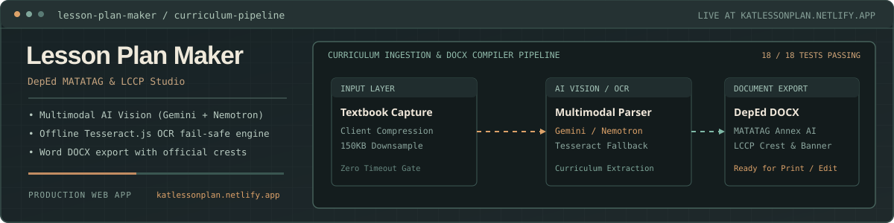
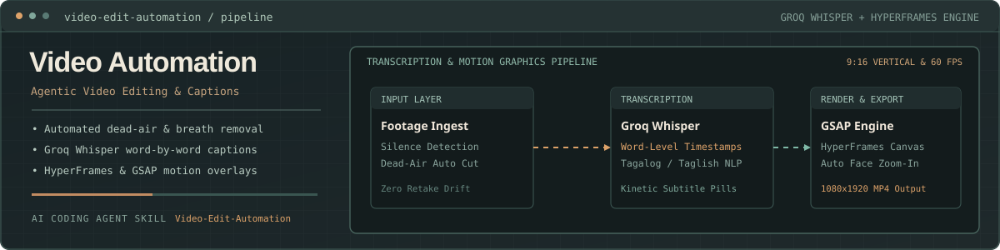
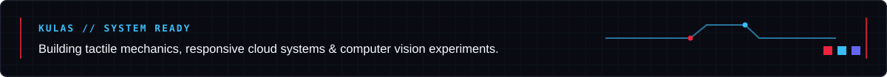

<!-- Profile README | KULAS? (@cuetolanderjohn-maker) -->

  

  
  
  
  
  
  
  

## Hey, I'm Kulas

I'm a **Computer Engineering** student at **ICCT Colleges**. On group projects and engineering teams, I'm usually the one designing the architecture, connecting multimodal AI APIs and automated pipelines, or building responsive mechanics from scratch.

I like building tools that solve immediate, practical problems and games that feel responsive and tactile. Right now I'm focused on **production AI curriculum software**, **agentic video automation**, alongside **retro 2D arcade engines**. When I'm not coding, there's a good chance I'm gaming or experimenting with a new project idea.

## My workbench

  

I've been spending time on full-stack AI web applications, automating media workflows with Groq Whisper and FFmpeg, and engineering deterministic 2D arcade loops.

## Projects

### [Lesson Plan Maker (LCCP Edition)](https://github.com/cuetolanderjohn-maker/lesson-plan-maker)

An automated curriculum architecture studio designed for educators at **La Consolacion College - Pasig**, transforming textbook photos into officially formatted lesson plans for **Kindergarten 2** and **Grade 1** matching DepEd MATATAG guidelines.

It features **multimodal cloud vision (Google Gemini & Nemotron)**, an **offline Tesseract.js OCR fail-safe engine**, client-side smart compression, and automated export to official Microsoft Word (.docx) documents with institutional crests and banners.

  

[Launch the live studio on Netlify](https://katlessonplan.netlify.app/) &bull; [Explore source code on GitHub](https://github.com/cuetolanderjohn-maker/lesson-plan-maker)

### [Video Edit Automation — Agentic Video Editor](https://github.com/cuetolanderjohn-maker/Video-Edit-Automation)

An automated personal video editor and transcription workflow powered by AI coding agents and **Groq Whisper**. You drop in raw footage and get back a cut, captioned edit with motion graphics, zoom-ins, and sound.

Built on **Node.js, FFmpeg, HyperFrames, and GSAP**, it supports vertical 9:16 reels, word-by-word animated captions, automated dead-air removal, and persistent style rule learning.

  

[Explore Video Edit Automation on GitHub](https://github.com/cuetolanderjohn-maker/Video-Edit-Automation)

### [Thunderbolt Arcade // Pacman: Pokemon Edition](https://github.com/cuetolanderjohn-maker/Pacman-Pokemon-Edition)

A custom 2D arcade engine I built that fuses classic Pacman mechanics with a Pokémon universe theme. It features a **deterministic tile-based collision loop**, electric power-pellet state machines, sprite animations, and procedural retro sound effects without external libraries.

  

[View the project and source code](https://github.com/cuetolanderjohn-maker/Pacman-Pokemon-Edition)

### [Lander's Interactive Cyber Portfolio](https://github.com/cuetolanderjohn-maker/landers-portfolio)

My personal portfolio website featuring a dark anime noir interface, live particle shaders, playable arcade mini-games, and modular quest logs.

[Explore the live portfolio](https://cuetolanderjohn-maker.github.io/landers-portfolio/) &bull; [View source code on GitHub](https://github.com/cuetolanderjohn-maker/landers-portfolio)

### [CPU Scheduler Simulation](https://github.com/cuetolanderjohn-maker/cpu-scheduler-simulation)

An algorithmic simulation of operating system process scheduling. It implements and compares **First-Come First-Served (FCFS)**, **Shortest Job First (SJF)**, **Priority Scheduling**, and **Round Robin (RR)** with visual timeline representations.

[Explore CPU Scheduler on GitHub](https://github.com/cuetolanderjohn-maker/cpu-scheduler-simulation)

## A retro arcade between commits

My GitHub contributions, reimagined as a classic retro arcade cabinet. Active commit days power up the grid, while a pixel player navigates the tiles at 60 frames per second.

<picture>
  <source media="(prefers-color-scheme: dark)" srcset="./assets/contribution-arcade.svg" />
  <source media="(prefers-color-scheme: light)" srcset="./assets/contribution-arcade-light.svg" />
  
</picture>

  

